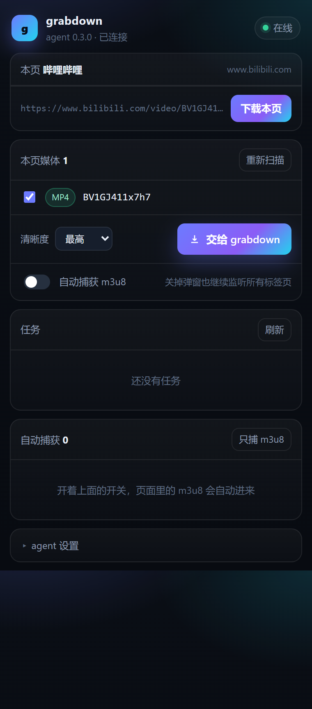

# grabdown — IDM 式多线程下载器 + 网页媒体提取


对标 Ghost Downloader（多线程/浏览器接管）与 dirpy（粘贴链接出文件），但只做一件事并做透：
**把一个 URL 变成文件**，媒体页就先解析成 m3u8/mp4 再下载。

```
python -m grabdown probe  URL          # 大小 / 是否支持 Range / 类型
python -m grabdown list   URL          # 列出可选清晰度
python -m grabdown get    URL          # 提取 + 下载（HLS 自动合流 mp4）
python -m grabdown dl     URL          # 纯文件分段下载（IDM 行为）
```

> 配套项目：[**panl**](https://github.com/sunday-lil/panl) —— 10 家网盘分享直链提取器（GUI/CLI）。
> grabdown 负责「直链 → 文件 / 网页视频 → 文件」，panl 解析出的直链可以直接丢过来下。

> **TL;DR (EN)** — An IDM-style downloader with a Chrome/Edge extension.
> Segmented multi-connection downloads with resume, HLS with AES-128 + ffmpeg remux,
> a local agent (REST + WebSocket for live progress), and platform detection for
> 21 sites: Bilibili / YouTube / Douyin / TikTok / X / Instagram … are delegated to
> yt-dlp, PornHub has a native extractor, everything else falls back to direct/HLS.
> 45 offline tests + 2 Node test suites.

---

## 1. 能力

| 模块 | 做了什么 |
|---|---|
| 分段引擎 | Range 切块 → 线程池并发 → 按序拼接；段大小 ≥1 MiB，线程数自动收敛 |
| 断点续传 | `<out>.grabstate.json` 记 url/etag/size + 每段完成量；重启只补没下完的段 |
| 单流回退 | 服务器 `Accept-Ranges: none` 时自动改单流（硬切会写坏文件，所以不切） |
| 进度 | 自己实现的单行进度条，多线程不刷屏；显示速度 / ETA |
| HLS | master 选码率（best/1080/720/…/worst）→ 分片并发 → AES-128 解密 → 拼接 |
| 合流 | 有 ffmpeg 就 `-c copy` 转 mp4（不重编码，几秒完成）；没有就留 .ts |
| 提取器 | 插件式：`direct` / `pornhub` / `generic`，注册即用 |
| 请求头 | 全局 `--ua/--referer/--cookie`，并按站点自动带 Referer |

## 2. 快速开始

```bash
# 普通文件：8 线程分段、断点续传
python -m grabdown dl "https://example.com/big.iso" -t 16 -o ./dl

# 网页里的视频
python -m grabdown list "https://www.pornhub.com/view_video.php?viewkey=phxxxx"
python -m grabdown get  "https://www.pornhub.com/view_video.php?viewkey=phxxxx" -q 1080 -t 12

# 已经是 m3u8 / mp4 直链
python -m grabdown get "https://cdn.example.com/x/master.m3u8" -q 720
```

`get` 的输出示例：

```
[pornhub] Some Video Title
  → hls auto https://ev.phncdn.com/videos/.../master.m3u8?hash=…
  码率: 1080p  (4 个可选)
Some_Video_Title_1080.mp4 ███████████████░░░░░░ 62.4%  128.3MB/205.6MB  8.4MB/s  ETA 9s

完成: ./Some_Video_Title_1080.mp4  (205.61 MB)
```

### 2.0 启动脚本

| 脚本 | 行为 |
|---|---|
| `AGENT.cmd` | 前台运行，日志直接打在窗口里（`[开始]/[完成]/[失败]`） |
| `AGENT-BG.cmd` | `pythonw` 后台运行，输出写 `agent.log`，随后自动跑一次 `doctor` |
| `STOP.cmd` | `python -m grabdown agent --stop`（走 `/shutdown`） |

**单实例**：启动前先 `GET /ping`，已有实例就直接打印地址并退出（rc=3）。
之前 `pythonw` + `SO_REUSEADDR` 能同时起 4 个，任务分散在不同进程里，UI 看着像丢了任务。

### 2.1 环境自检

```bash
python -m grabdown doctor
```

会打印 python / 可执行文件 / **ffmpeg 路径与版本** / agent 是否在线 / 下载目录。

ffmpeg 的查找顺序（`grabdown/tools.py`）：

1. `GRAB_FFMPEG`（或 `FFMPEG`）环境变量
2. `PATH` 里的 `ffmpeg`
3. `~/.grabdown/ffmpeg`
4. 常见安装位置：`D:\ffmpeg\bin`、`D:\tools\ffmpeg\bin`、`C:\ffmpeg\bin`、choco 的 `bin` …

每个候选都会**真跑一次 `ffmpeg -version`**，返回码不对就跳过 —— 因为 `pythonw` / 计划任务里 PATH 常被裁掉，
`which` 拿到一个坏 exe 比拿不到更糟（合流时才炸）。

## 3. 浏览器扩展（Chrome / Edge）



### 3.1 先起本地代理

```bash
python -m grabdown agent              # 默认 127.0.0.1:8899
python -m grabdown agent --out D:/dl --token s3cret --workers 3
```

agent 就是扩展的后端：扩展只负责"看到媒体 → 发任务"，真正的分段下载、HLS 解密、
ffmpeg 合流都在本机进程里跑，**视频不经过任何第三方服务器**。

### 3.2 装扩展

1. 打开 `chrome://extensions`（Edge 是 `edge://extensions`）→ 打开「开发者模式」
2. 「加载已解压的扩展程序」→ 选本仓库的 `ext/` 目录（或直接下
   [release 里的 `grabdown-ext-*.zip`](https://github.com/sunday-lil/grabdown/releases/latest) 解压后选里面的 `ext/`）
3. 图标出现在工具栏；`Alt+Shift+G` 打开面板

### 3.3 能干什么

| 入口 | 行为 |
|---|---|
| 页面右下角浮标 | 自动统计本页发现的 m3u8/mp4，点一下全部交给 grabdown |
| 工具栏面板 | 勾选要下的、选清晰度（最高/1080/720/最低）、看任务进度条 |
| 右键菜单 | 「用 grabdown 下载此链接 / 此媒体」 |
| agent 离线 | 普通 mp4 自动退回 `chrome.downloads`（无多线程）；m3u8 会提示先起 agent |

检测来源：`<video>/<source>`、`<a href>`、`performance` 资源条目（HLS 通常走 XHR，
DOM 上看不到，这一条最关键）、以及内联脚本里的 m3u8 字面量（`flashvars` 那类）。
SPA 路由变化会重新扫描。

### 2.4 agent 接口（扩展 ↔ 本机）

```
GET  /ping            → {ok, version}
GET  /jobs            → {jobs:[{id,state,percent,out_path,...}]}
POST /jobs            → {url, kind?, quality?, referer?, cookie?, threads?}
GET  /jobs/<id>       → 单任务
POST /jobs/<id>/cancel
```

CORS 全放开但只监听 `127.0.0.1`；需要更强隔离就加 `--token`，扩展设置里填同一个。
权限清单：`downloads`（离线回退）、`storage`（存 agent 地址）、`contextMenus`、`tabs`、
`notifications`、`scripting`、`<all_urls>`（要在任意站点上找媒体）。


### 3.5 自动捕获（关掉弹窗也生效）

面板里的「自动捕获 m3u8」开关打上后，**content script 会在所有标签页持续工作**，
不依赖弹窗是否打开：

- 每页发现 m3u8 → 上报 background → 去重（`chrome.storage.session` 记已提交的 URL）→ 自动提交给 agent；
- 默认只自动下 m3u8（播放器真正在放的那条），点「只捕 m3u8」可切成 `m3u8 + mp4`；
- 提交记录进「自动捕获」区，失败/离线会标出来；
- SPA 切路由、动态插入 `<video>` 都会重新扫描（MutationObserver + pushState 钩子）。

### 3.6 实时进度走 WebSocket

```
ws://127.0.0.1:8899/ws          ← 扩展内部用的地址，设置里请填 http://127.0.0.1:8899
← {type:"hello", jobs:[...]}
← {type:"job", job:{id,state,percent,done_bytes,total_bytes}}
```

- 服务端在 `grabdown/ws.py`（自写 RFC6455，纯标准库，无第三方依赖）；
- 进度回调按 **150ms 节流**广播，面板进度条是真·实时；
- **设置里的「地址」填 `http://127.0.0.1:8899`，不要填 `ws://…/ws`** —— 填错了会自动纠正（`normalizeAgentUrl`），保存后也会告诉你连没连上；
- WS 连不上时自动退回 1.2s 轮询，界面右上角会显示「WS 断开，退回轮询」；
- 三重兜底：① 后台旧版本不带 `ws` 字段 → 面板自己用 `agentUrl` 推出 `ws://…/ws`；② WS 3.5s 没 OPEN → 视为超时，转轮询（`WS 超时 · 已退回轮询（点我重连）`）；③ ping 失败每 3s 自动重试，agent 后起也能自己连上；
- 提交/取消/完成都会推一帧（不等节流）。

### 3.6.1 面板自检行

设置区最上面有一行等宽小字，例如：

```
后台 v1.0.5 · 权限 downloads, storage, alarms, contextMenus, tabs, notifications, scripting, activeTab · 正常
```

- 它来自后台的 `diag` 消息（`chrome.runtime.getManifest()` + 各 API 是否存在）；
- SW 挂掉时这里会变红：`后台没起来（timeout）→ edge://extensions 点刷新`，
  同时状态栏写「扩展后台未运行」，媒体列表也会提示 —— 不用再猜“为什么点了没反应”。

### 3.7 扩展的离线测试

```bash
node ext/test/auto.test.mjs        # 后台逻辑（自动捕获/去重/设置）
node ext/test/manifest.test.mjs    # manifest ↔ 代码一致性（权限缺一个 SW 就注册失败）
```

用 chrome / fetch 桩把 `background.js` 拉起来，覆盖：关闭开关不上报、只挑 m3u8、
同 URL 去重、新 URL 提交、`autoAll` 后 mp4 也下、`auto-log` 记录、settings 读写、
地址规范化（`ws://` → `http://`）、保存流程。

`manifest.test.mjs` 会扫描三个 JS 里用到的 `chrome.*`，和 manifest 的 `permissions` 对一遍 ——
起因是 `chrome.alarms` 少了权限，SW 一注册就 `TypeError`，浏览器只报
`Service worker registration failed. Status code: 15`，界面上则表现为「点什么都没反应」。

## 4. 平台识别与主流站点

```bash
python -m grabdown platforms          # 看支持哪些站、各用什么引擎
python -m grabdown list  "https://www.bilibili.com/video/BV1xx411c7mD"
python -m grabdown get   "https://www.bilibili.com/video/BV1xx411c7mD" -q 1080
```

三种引擎分工：

| 引擎 | 覆盖 | 说明 |
|---|---|---|
| `native` | PornHub | 自己写的解析器，不依赖外部工具 |
| `ytdlp` | B 站 / YouTube / 抖音 / 快手 / 西瓜 / 微博 / 小红书 / TikTok / X / Instagram / Vimeo / Twitch / SoundCloud / XVideos / XNXX … | 交 [yt-dlp](https://github.com/yt-dlp/yt-dlp)（1800+ 站点），我们只管认平台、传 cookie、报进度 |
| `direct` | 任意 `.m3u8` / `.mp4` | 直接走分段引擎 |

```bash
python -m pip install -r requirements.txt   # requests / yt-dlp / cryptography
python -m grabdown doctor                   # 显示 yt-dlp、cryptography、ffmpeg 版本
```

> `cryptography` 只有「AES-128 加密的 HLS」才用得到；缺了会明确提示装它，不会静默失败。
> `yt-dlp` 负责主流平台，`ffmpeg` 负责合并音视频 / 转 mp4。

为什么不自研 B 站/YouTube：

- B 站：`wbi` 签名 + DASH 音视频分离 + 大会员清晰度校验，接口一年改好几次；
- YouTube：`player` JS 里的签名要跟着改，几乎每周变；
- 抖音：`a_bogus` 参数由 JS 混淆生成。

自己维护 20 个站 = 20 个会烂的解析器。所以：**认平台（本地、零请求）→ 交 yt-dlp 拿格式和签名 → 合并交给 ffmpeg**。
`MediaInfo` 里统一用 `kind="ytdlp"` 表示这条路，`Format.url` 存的是页面地址（yt-dlp 需要页面，不是直链）。

实测（B 站 BV1GJ411x7h7，360p）：

```
[开始] BV1GJ411x7h7
[完成] … → 【官方 MV】Never Gonna Give You Up - Rick Astley [BV1GJ411x7h7].mp4  (9.17 MB)
ffprobe: av1 360p + aac / 212s
```

## 5. PornHub 这条链路具体怎么走的

1. `GET view_video.php?viewkey=…`，带
   `Cookie: platform=pc; age_verified=1; accessAgeDisclaimerPH=1`
   （不带就是年龄门，页面里没有 flashvars）
2. 从 HTML 里抠 `"mediaDefinitions": [ … ]`（括号配对解析，不用正则硬啃 JSON）
3. 每项长这样：

```json
{"format":"hls","videoUrl":"https://ev.phncdn.com/videos/.../master.m3u8?validfrom=&hash=","quality":"auto"}
{"format":"mp4","videoUrl":"https://ev.phncdn.com/videos/.../1080P_4M.mp4","quality":"1080","height":1080}
```

4. 选 `hls` 就走 master → 变体 → 分片；选 `mp4` 就走分段引擎直接拉
5. CDN 请求统一带 `Referer: https://www.pornhub.com/`

**签名会过期**：`hash`/`validfrom` 是短时的，链接放久了就 403 —— 重新 `get` 一次即可，
提取器每次都会重新抓页面。

## 6. 与 Ghost Downloader / dirpy 的差别

| | Ghost Downloader | dirpy | grabdown |
|---|---|---|---|
| 形态 | 桌面 GUI + 浏览器扩展 | 在线服务 | 本地 CLI |
| 多线程 | ✅ | 服务端 | ✅（Range 分段） |
| 断点续传 | ✅ | — | ✅（段级状态文件） |
| HLS/AES | 部分 | ✅ 服务端 | ✅（AES-128 + ffmpeg 合流） |
| 站点解析 | 靠扩展嗅探 | 服务端 | 插件式提取器，本地解析 |
| 数据去向 | 本机 | 链接交给第三方 | 本机 |

没有做：浏览器扩展、GUI、DRM（Widevine/PlayReady）、付费墙/登录态盗用。
前三项都能加，DRM 那类不在范围内 —— 那已经不是"下载器"该干的事。

## 7. 结构

```
grabdown/
├── http.py        # Session：header、HEAD/Range 探测、带重试的字节流
├── engine.py      # 分段计划 / 线程池 / 续传状态 / 合并落盘 / 进度条
├── hls.py         # m3u8 解析、码率选择、AES-128、分片并发、ffmpeg -c copy
├── extract.py     # Format/MediaInfo、提取器注册、泛型扫描
├── platforms.py   # 平台识别表（21 个站）+ 引擎路由
├── ytdlp_backend.py  # yt-dlp 后端：格式/下载/进度 hook
├── sites/__init__.py  # PornHub 提取器 + Generic 兜底（注册即生效）
├── cli.py         # probe / list / get / dl
└── tests/         # 16 个用例：本地 Range 服务器 + AES 分片 + 提取器
```

跑测试：

```bash
python -m unittest discover -s grabdown/tests -t . -v
```

覆盖点：多线程下载哈希一致、无 Range 只发一次 GET、续传只补缺段、m3u8 master 选码率、
AES-128 解密拼接、PH flashvars 解析（含年龄门报错）、泛型扫描、质量选择策略。

## 8. 加一个站点

```python
# grabdown/sites/mysite.py
from ..extract import Extractor, Format, MediaInfo, register

class MySite(Extractor):
    name = "mysite"
    def match(self, url): return "mysite.com" in url
    def extract(self, session, url):
        html, final = session.get_text(url, headers={"Referer": url})
        # …从 html 里抠出 m3u8 / mp4…
        return MediaInfo(site=self.name, title="…", page_url=final,
                         formats=[Format(quality="1080", url=m3u8, kind="hls", height=1080)],
                         headers={"Referer": final})

register(MySite())
```

在 `grabdown/sites/__init__.py` 末尾 `from . import mysite  # noqa` 即可，CLI 自动用上。

## 9. 已知限制

- HLS 的 `#EXT-X-BYTERANGE`（单文件内分段）未处理，遇到请反馈；
- 只实现了 AES-128，SAMPLE-AES / fMP4 CENC 不碰；
- `probe` 依赖服务器给 `Content-Length`；给不出时自动退单流；
- Windows 上拼接是"分片文件 → 合并"，峰值磁盘占用约为文件大小 ×2。
